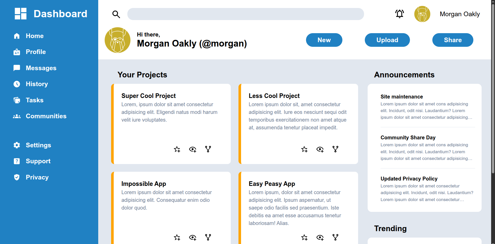

# Admin Dashboard

A dashboard page built with HTML and CSS as part of [The Odin Project](https://www.theodinproject.com/). The layout uses CSS Grid and Flexbox to organize a sidebar, profile header, project cards, announcements, and trending users.

## Preview



## Features

- Sidebar navigation with dashboard, profile, messages, history, tasks, communities, settings, support, and privacy links
- Header with search field, notification icon, profile details, and action buttons
- Project cards with sample project descriptions and action icons
- Announcements and trending user sections
- Custom SVG icons and a shared avatar image

## Built With

- HTML5
- CSS3, including CSS Grid and Flexbox

## Run Locally

Clone or download this repository, then open `index.html` in a web browser. No build step is required.

## Project Files

```text
.
├── Images/
│   ├── admin-dashboard.png
│   └── odin-lined.png
├── icons/
├── index.html
├── style.css
└── README.md
```

## Credits

This project was created as an exercise in The Odin Project's Intermediate HTML and CSS course. Sample dashboard text and profile names are included for demonstration.
